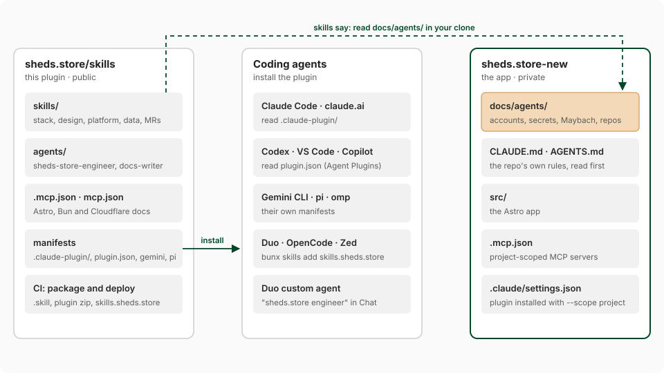

# sheds-store agent plugin

**Teach any coding agent how [sheds.store](https://sheds.store) is built, then let it ship merge requests.**

Skills, agents, rules and MCP servers for [`sheds.store-new`](https://gitlab.com/davidbodnar/sheds.store/sheds.store-new): [Astro](https://astro.build) with [Vue](https://vuejs.org) islands, [Tailwind CSS](https://v3.tailwindcss.com), [Supabase](https://supabase.com), on one [Cloudflare Worker](https://developers.cloudflare.com/workers/). Install it, open a sheds.store checkout, and ask for a feature. The agent builds it in the existing stack and opens an MR into `develop`.




| | |
| --- | --- |
| **Primary repo** | [davidbodnar/sheds.store/sheds.store-new](https://gitlab.com/davidbodnar/sheds.store/sheds.store-new) |
| **Also covered** | The [Maybach integration contract](skills/sheds-store-maybach-contract/SKILL.md), and an [orientation](skills/sheds-store-systemavo-reference/SKILL.md) for the SystemAvo repos that aren't sheds.store |
| **Works with** | Claude Code, claude.ai, Claude Desktop, Cowork, Codex, GitHub Copilot, VS Code, GitLab Duo, OpenCode, Zed, pi, oh-my-pi, Gemini CLI |
| **Downloads** | [skills.sheds.store](https://skills.sheds.store) |
| **Plan** | [specs/](specs/), indexed in [AGENTS.md](AGENTS.md#specs) |

## Contents

- [Install](#install)
- [Upload by hand](#upload-by-hand)
- [Private details](#private-details)
- [What's inside](#whats-inside)
- [Packages and CI](#packages-and-ci)
- [GitLab Duo](#gitlab-duo)
- [Develop](#develop)

## Install

Point an agent at **<https://skills.sheds.store**>. Everything installs from there, or from the git repos.

### Claude Code

The marketplace is added once per account. The plugin can be installed for you, or for everyone who works in a repo:

```sh
claude plugin marketplace add https://skills.sheds.store/marketplace.json
claude plugin install sheds-store@sheds-store                    # just you (user scope)
claude plugin install sheds-store@sheds-store --scope project    # everyone in this repo, via .claude/settings.json
```

The same works in a session as `/plugin marketplace add …` and `/plugin install …`.

### claude.ai, Claude Desktop, Cowork

**Customize > Plugins > Add marketplace > Add from a repository**, enter `danielbodnar/skills.sheds.store`, and turn on **Sync automatically**. Your Claude account needs access to that GitHub repo. Or [upload the files by hand](#upload-by-hand).

### Agents that read `.agents/skills`

GitLab Duo, Codex, Copilot, OpenCode, Zed, pi:

```sh
bunx skills@latest add https://skills.sheds.store --all       # this repo
bunx skills@latest add https://skills.sheds.store --all -g    # every repo, for your user
```

The git repos work as sources too: `https://gitlab.com/davidbodnar/sheds.store/skills` or `danielbodnar/skills.sheds.store`.

### Other plugin hosts, from git

These need read access to the repo, and a git credential that works without a prompt.

| Tool | Install |
| --- | --- |
| [Codex](https://developers.openai.com/codex/plugins/build) | `codex plugin marketplace add https://gitlab.com/davidbodnar/sheds.store/skills.git` |
| [GitHub Copilot CLI](https://docs.github.com/en/copilot/reference/cli-plugin-reference) | `copilot plugin install https://gitlab.com/davidbodnar/sheds.store/skills.git` |
| [VS Code](https://code.visualstudio.com/docs/agent-customization/agent-plugins) | Command palette: **Chat: Install Plugin From Source**, then paste the clone URL |
| [oh-my-pi](https://github.com/can1357/oh-my-pi) | `omp plugin marketplace add https://gitlab.com/davidbodnar/sheds.store/skills.git`, then `omp plugin install sheds-store@sheds-store` |
| [pi](https://github.com/earendil-works/pi) | `pi install git:gitlab.com/davidbodnar/sheds.store/skills` |
| [Gemini CLI](https://geminicli.com/docs/extensions/reference/) | `gemini extensions install https://gitlab.com/davidbodnar/sheds.store/skills.git` |

### Vendor plugins

sheds.store work also uses these. Install them from their own sources, not from this marketplace, so nobody ends up with two plugins of the same name.

| Plugin | Install in Claude Code |
| --- | --- |
| Cloudflare (skills and the Code Mode MCP server) | `/plugin install cloudflare@claude-plugins-official` |
| Supabase | `/plugin install supabase@claude-plugins-official` |
| GitLab (MCP server) | `/plugin install gitlab@claude-plugins-official` |
| Resend | `/plugin install resend@claude-plugins-official` |
| Vue | `/plugin marketplace add vuejs-ai/skills`, then install `vue-skills-bundle@vue-skills` |
| 1Password | `/plugin marketplace add 1Password/1password-claude-plugin`, then install `1password@1password` |
| Google Maps | `bunx skills@latest add googlemaps/agent-skills` |

For the GitLab CLI skills, run [`glab skills install`](https://docs.gitlab.com/cli/skills/install/).

## Upload by hand

For claude.ai, Claude Desktop and Cowork, or any agent where you'd rather upload files than add a marketplace. Everything is at [skills.sheds.store](https://skills.sheds.store), with checksums in [`SHA256SUMS`](https://skills.sheds.store/SHA256SUMS).

| File | Upload under | Contains |
| --- | --- | --- |
| [`sheds-store.zip`](https://skills.sheds.store/plugins/sheds-store.zip) | **Customize > Plugins** | The whole plugin: skills, agents, MCP config |
| `<skill>.skill`, one per skill, linked from the [skills table](https://skills.sheds.store) | **Customize > Skills** | One skill folder |

The same files are attached to every [release](https://gitlab.com/davidbodnar/sheds.store/skills/-/releases), and to every pipeline as the `packages` artifact.

## Private details

This plugin is written to be publishable. Account IDs, secret locations, the Maybach endpoints and auth, and the map of related repos live in the private sheds.store-new repo, under `docs/agents/`. A skill that needs one of them names the file, and the agent reads it in its clone. Without a clone, the agent says what it can't see and asks for access.

`bun run validate` runs [`scripts/check-public.ts`](scripts/check-public.ts), which fails on identifiers and known private names.

## What's inside

### Skills

Start with [`sheds-store`](skills/sheds-store/SKILL.md). It routes to the rest.

| Skill | Use for |
| --- | --- |
| [`sheds-store`](skills/sheds-store/SKILL.md) | The product, repo map, stack, and the rules that get an MR rejected |
| [`sheds-store-frontend`](skills/sheds-store-frontend/SKILL.md) | Pages, Vue islands, calculators and widgets, porting React to Vue |
| [`sheds-store-design-system`](skills/sheds-store-design-system/SKILL.md) | Colours, type, buttons, dashboard tokens. Ships [`DESIGN.md`](skills/sheds-store-design-system/DESIGN.md) and [`tokens.json`](skills/sheds-store-design-system/references/tokens.json) |
| [`sheds-store-platform`](skills/sheds-store-platform/SKILL.md) | Host routing, caching, env and secrets, crons, wrangler, deploys |
| [`sheds-store-data`](skills/sheds-store-data/SKILL.md) | Supabase clients, RLS, migrations, dealer lifecycle, plans and billing |
| [`sheds-store-maybach-contract`](skills/sheds-store-maybach-contract/SKILL.md) | What crosses the boundary with Maybach, and the rules for changing it |
| [`sheds-store-contributing`](skills/sheds-store-contributing/SKILL.md) | Branches, commits, MRs, checks |
| [`sheds-store-secrets`](skills/sheds-store-secrets/SKILL.md) | Loading secrets with `op run`, public versus server variables, adding a variable |
| [`sheds-store-systemavo-reference`](skills/sheds-store-systemavo-reference/SKILL.md) | The repos that aren't sheds.store |
| [`sheds-store-writing-docs`](skills/sheds-store-writing-docs/SKILL.md) | READMEs, guides, specs, changelogs and blog posts: accuracy, structure, plain prose |

### Agents

| Agent | Does |
| --- | --- |
| [`sheds-store-engineer`](agents/sheds-store-engineer.md) | Builds a change end to end and opens the MR |
| [`sheds-store-docs-writer`](agents/sheds-store-docs-writer.md) | Keeps the README, `AGENTS.md` and blog posts true to the code |

### MCP servers

Defined in [`.mcp.json`](.mcp.json) (Claude) and [`mcp.json`](mcp.json) (Agent Plugins). Only servers no vendor plugin already provides:

| Server | URL |
| --- | --- |
| Cloudflare docs | `https://docs.mcp.cloudflare.com/mcp` |
| [Astro docs](https://github.com/withastro/docs-mcp) | `https://mcp.docs.astro.build/mcp` |
| Bun docs | `https://bun.com/docs/mcp` |

The Cloudflare, Supabase, GitLab and Resend servers come with their [vendor plugins](#vendor-plugins).

### Manifests

| File | Read by |
| --- | --- |
| [`.claude-plugin/plugin.json`](.claude-plugin/plugin.json), [`.claude-plugin/marketplace.json`](.claude-plugin/marketplace.json) | Claude Code, claude.ai, Cowork, Codex, Copilot CLI, omp, the `skills` and `plugins` CLIs |
| [`plugin.json`](plugin.json), [`mcp.json`](mcp.json) | [Agent Plugins 1.0](https://agent-plugins.org): Codex, VS Code, Copilot CLI, omp |
| [`gemini-extension.json`](gemini-extension.json) | Gemini CLI |
| [`package.json`](package.json) | pi, and this repo's scripts |

## Packages and CI

[`.gitlab-ci.yml`](.gitlab-ci.yml) runs four jobs:

| Job | Runs on | Does |
| --- | --- | --- |
| `validate` | Every pipeline | [`scripts/validate.ts`](scripts/validate.ts): frontmatter, manifests, MCP config, `check-public` |
| `package` | Every pipeline | [`scripts/build-site.ts`](scripts/build-site.ts): a `.skill` per skill, `sheds-store.zip`, the marketplace, the discovery index and the landing page, into `site/dist/`. Kept as the `packages` artifact, linked from each MR. |
| `deploy` | The default branch | Publishes `site/dist/` to [skills.sheds.store](https://skills.sheds.store) with wrangler |
| `release` | Tags like `v1.2.0` | Creates a GitLab release with the packages as assets, stored in the generic package registry |

`deploy` needs two CI/CD variables, and is skipped until they exist:

| Variable | Value |
| --- | --- |
| `CLOUDFLARE_API_TOKEN` | Masked and protected. A token that can edit Workers scripts and routes for the account and the `sheds.store` zone. |
| `CLOUDFLARE_ACCOUNT_ID` | The Cloudflare account that owns the Worker |

To cut a release, tag `main`: `git tag v1.2.0 && git push origin v1.2.0`.

## GitLab Duo

The **sheds.store engineer** custom agent lives in the [AI Catalog](https://gitlab.com/explore/ai-catalog), restricted to the `davidbodnar` group. Its prompt is [`duo/system-prompt.md`](duo/system-prompt.md) and its tools are [`duo/agent-tools.txt`](duo/agent-tools.txt). Update it with [`duo/create-agent.sh`](duo/create-agent.sh).

[`duo/README.md`](duo/README.md) covers what Duo reads from where, and the steps that need a top-level group owner.

## Develop

```sh
bun run validate      # skill frontmatter, manifests, MCP config, claude plugin validate
```

[CI](.gitlab-ci.yml) runs the same check, plus SAST and secret detection. Build the packages locally with `bun run site:build`; commit first, because they come from `git archive HEAD`. Rules for editing this repo are in [`AGENTS.md`](AGENTS.md).
