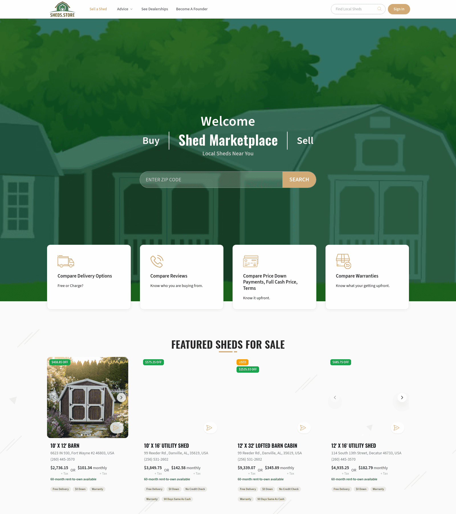
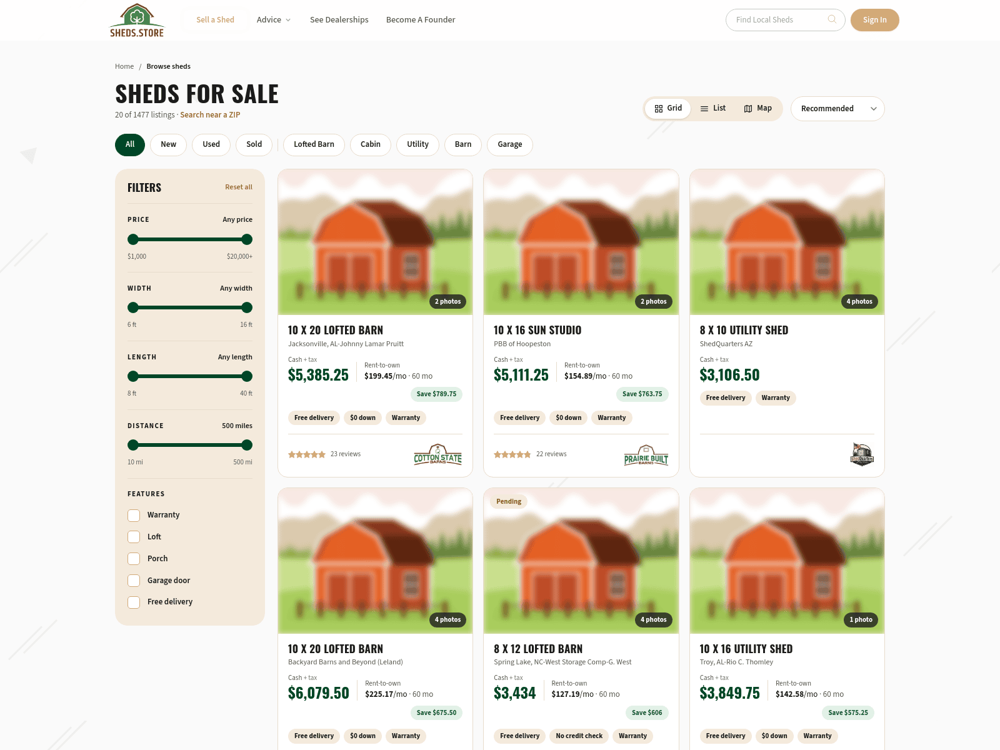
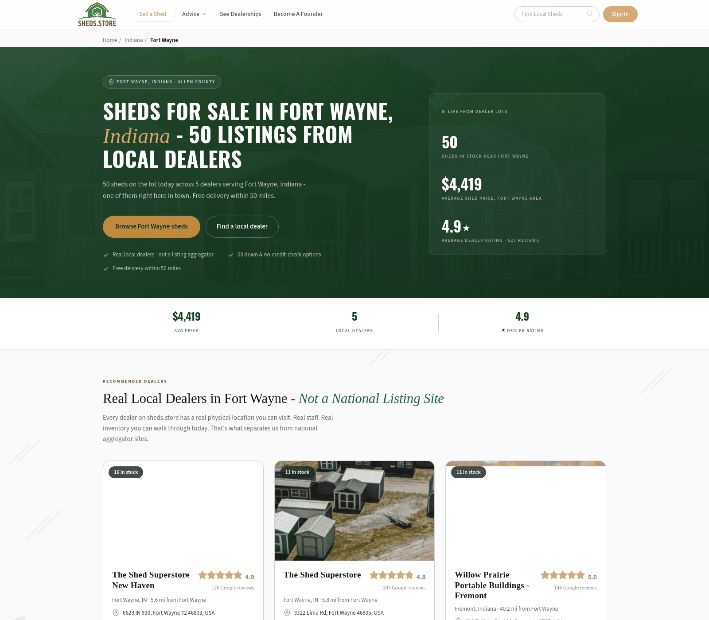
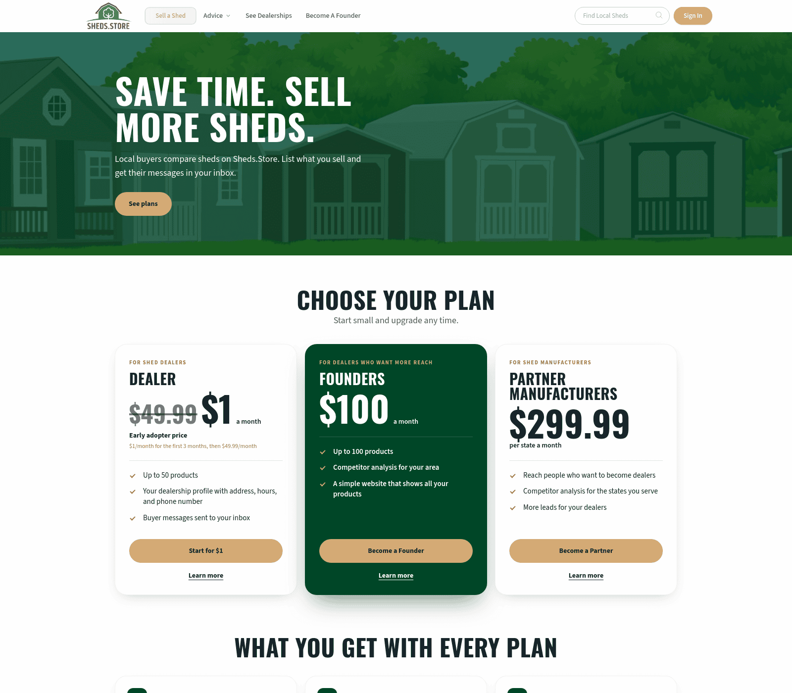
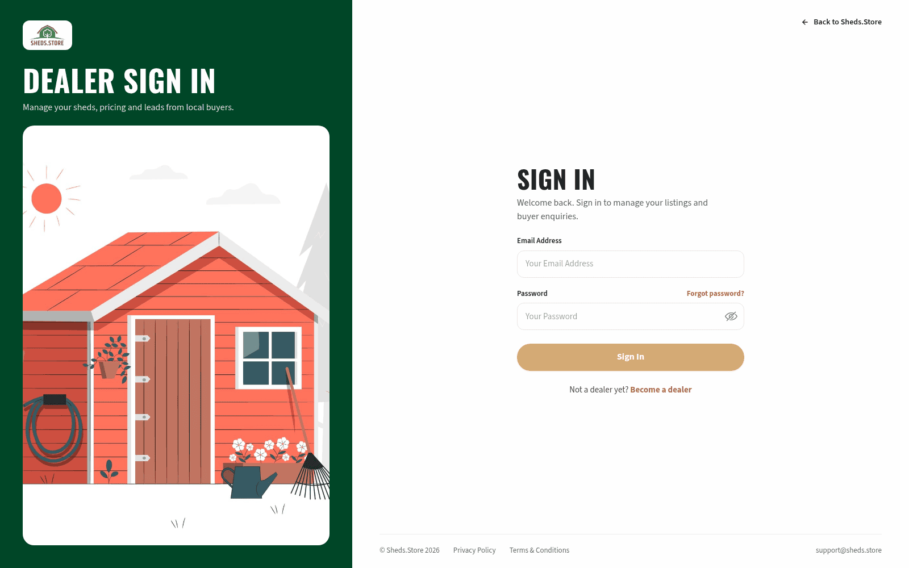
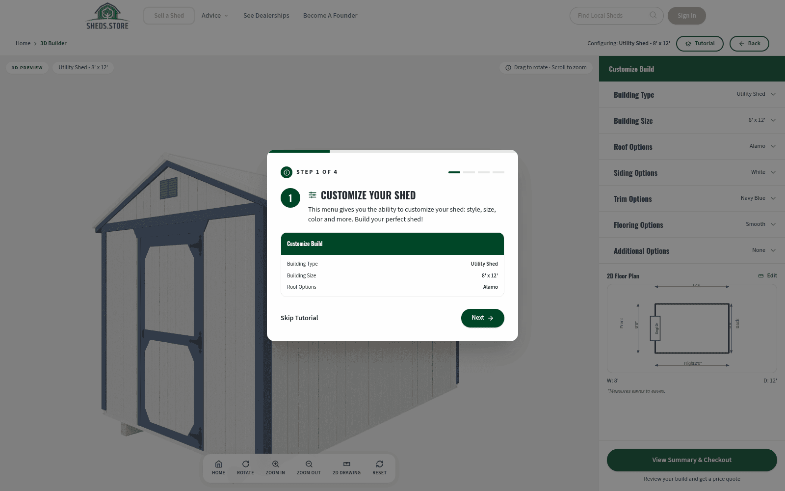
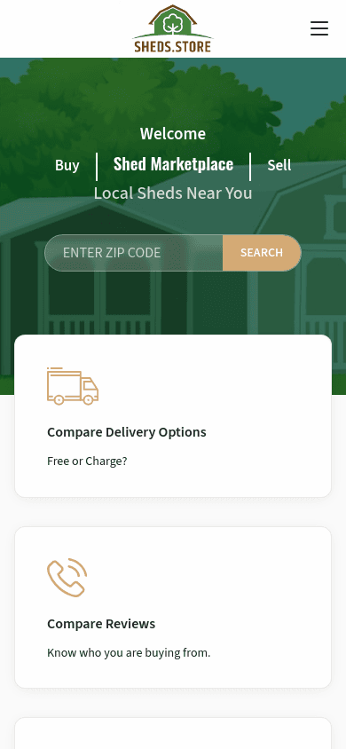
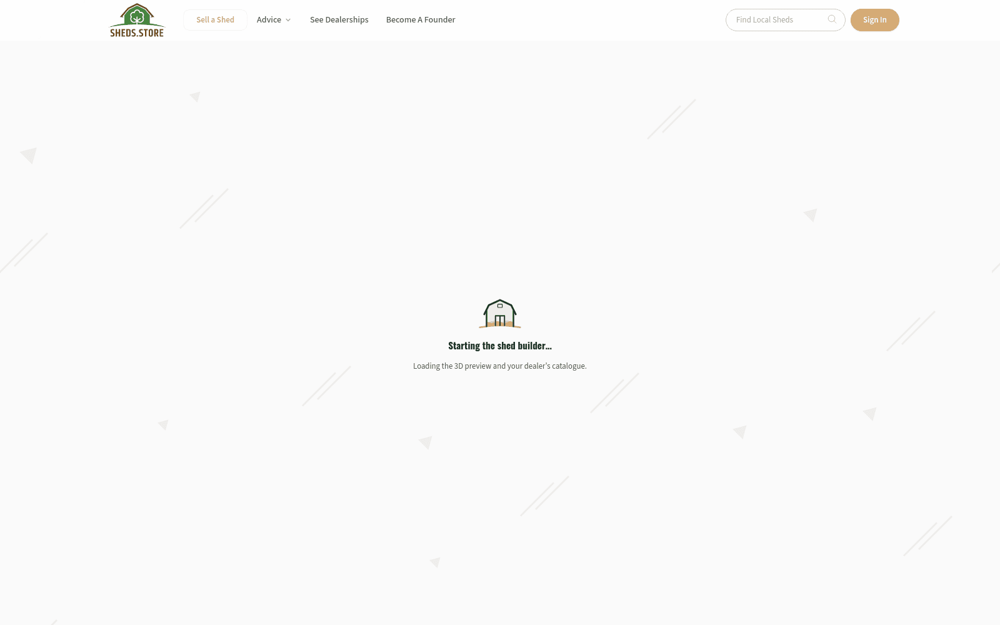

# sheds.store design

## Overview

A shed marketplace for buyers and dealers. The look borrows from warehouse and lumber-yard signage: condensed uppercase headings, a cream paper background, deep forest green for anything you can press, and a warm tan as the brand accent. It should feel practical and trustworthy rather than glossy.

There are four surfaces:

1. **Marketplace** (sheds.store, dealer stand-alone sites): cream background with a subtle texture, a white sticky header, green illustrated heroes, white cards, tan primary buttons, and a forest green footer.
2. **Dashboard** (dashboard.sheds.store): a paper-coloured workspace. Beige sidebar, cream canvas, white cards on warm hairlines, green for actions, gold for things needing attention.
3. **City and variant pages**: editorial landing pages with a dark forest hero, gold highlights, and Georgia serif section headings.
4. **Auth** (auth.sheds.store): no site header or footer. A forest green brand panel with an illustration on the left, a white form column on the right.

## Logo

A green barn with a white tree in its doorway, on a curved green hill, over a "SHEDS.STORE" wordmark. The roof and wordmark are brown `#6e4716` and the barn is green `#45843b`. On dark or green backgrounds the roof and wordmark turn white. The files are in `assets/brand/`: `logo.svg`, `logo-on-dark.svg`, `mark.svg` (barn only) and the favicon set. Always use the files. Never retype the name in Oswald as a wordmark. The logo colours aren't UI colours.

## Colors

- **Forest green `#004627`** is the action and link colour, and the dashboard primary button.
- **Tan `#D4AA75`** is the brand accent and the marketplace primary button fill. It's low-contrast on cream, so it's never used for body text on light backgrounds.
- **Cream `#fafafa`** page background in light mode, **charcoal `#2a2b2c`** in dark mode, with `#393b3d` cards.
- **Coral `#ff735c`** marks alerts and sold items.
- Text is near-black `#272727` on light and warm white `#fdfaf7` on dark.
- The listing page (`/sheds`) has its own warm set: cream `#f4eadc` for panels and tags, `#e6dccb` hairlines, and a darker tan `#9a6b2f` for links.
- Auth pages use `#a9783a` for links, a tan dark enough to read on white.

Every marketplace colour has a dark-mode pair in the CSS. Visitors can't reach it: the header toggle is commented out and there's no system-preference fallback. The dashboard is light-only.

## Typography

- **Oswald** (condensed sans, max weight 700) for headings and big numbers. h1–h3 are bold and uppercase. h4–h6 are semibold and sentence case.
- **Source Sans 3** for body, labels, forms and buttons.
- **Georgia** (system serif) only for city page section headings and pull quotes. Those aren't uppercased.
- Every size scales smoothly from a 375px to a 1280px viewport. Body is 16→18px with 1.6 line height. Long-form text is capped at 66 characters per line.
- Exceptions: the home hero's "Shed Marketplace" is title case, not capitals. The city hero sets one word of its capital headline in italic gold Georgia.
- Small labels (plan eyebrows, city stats, filter group names) are 11–12px letter-spaced capitals in Source Sans 3.

## Layout

- Content sits in a centred container up to 1302px wide with 12px side padding. Sections have 64px vertical padding.
- Breakpoints: 576, 768, 992, 1200, 1400, 1600px.
- The dashboard is a two-column app frame: a 240px sidebar from 992px up, a 64px icon rail on tablets, and a top bar with a slide-in sidebar on phones.

## Elevation and depth

Flat by default. Cards use a 1px hairline border (`#e9e3d8` in the dashboard) and a barely-there shadow (`0 1px 2px rgba(29,28,25,0.04)`). Modals and popovers get a deeper soft shadow (`0 18px 40px -12px rgba(29,28,25,0.22)`).

## Shapes

- Buttons, chips and tags are pills. The main exception is "Sell a Shed" in the header, which has 8px corners.
- Status badges on home page shed photos have 6px corners.
- Listing cards have 16px corners. Dashboard cards have 14px corners. City page cards have 6px corners.

## Components

- **Button, primary (marketplace):** pill, 46px high, 28px horizontal padding, 14px semibold text, tan `#D4AA75` fill with near-black `#222` text (7.4:1), the same in dark mode. The live site uses white text, which is only 2.1:1, so don't copy it. Brightens on hover.
- **Button, outline (marketplace):** 2px tan border, `#9a6b2f` text (tan text fails on white), fills tan on hover.
- **Button, on photo:** white 60% border and white text, 15% white fill on hover.
- **Button (dashboard):** pill, 13.5px bold. Variants: green primary, white outline (ink border on hover), black, gold. Compact size available.
- **Card (dashboard):** white surface, warm hairline border, 14px radius, Oswald title, muted subtitle.
- **Banner (dashboard):** inline alert with an icon, a bold one-line summary, and an optional pill action.
- **Pill (dashboard):** small rounded status tag.
- **Button, plan card (sell a shed):** full-width tan pill with dark text, 14px bold. A "Learn more" underlined link sits under it.
- **Button, city hero:** gold `#c08a3e` pill with dark green text, beside a transparent pill with a faint white border.
- **Form field:** label above input, help text below in muted colour. Selects use a drawn caret.
- **Header:** sticky, white at 90% with a backdrop blur. Logo, a white "Sell a Shed" button with a pulsing tan ring, plain nav links that turn tan on hover, a pill ZIP search, and a tan "Sign In" pill. A hairline and soft shadow appear once the page scrolls. Phones get a centred logo and a hamburger.
- **Footer:** forest green, four columns, uppercase `#ebebeb` column titles, `#cbcbcb` links that turn tan on hover. A grid of city links sits in 65% white and turns white on hover.
- **Home hero:** an illustrated shed yard tinted forest green, centred white type, a long pill ZIP search with a tan "SEARCH" end cap, and four white feature cards with tan line icons overlapping its lower edge.
- **Section title:** Oswald capitals, centred, with a short two-part tan underline.
- **Shed card, listing page:** white, 16px corners, warm hairline border, deeper shadow on hover. 4:3 photo with a dark photo-count pill. Oswald capital title on one line, dealer in muted text, cash price in green Oswald 24px beside a rent-to-own monthly figure, then tag pills. A star rating and the dealer logo sit under a hairline. Sponsored cards get a warm tint and a tan border.
- **Shed card, home page:** unframed. A square photo carousel with rounded corners, status badges top left, a contact button bottom right, then the title, address, phone, cash "OR" monthly price, and feature pills.
- **Tag pill (listing):** 11px bold. Cream by default. Green tint for savings, blue for used, yellow for pending, red tint for sold, solid red for hot, green tint for popular.
- **Status badge (home):** 12px uppercase on a solid colour, 6px corners. Dark green `#15803d` with white text for a discount. Amber and yellow with near-black text for used and pending. Red for sold.
- **Filter panel (listing):** a cream rounded panel with an Oswald "FILTERS" title, letter-spaced capital group labels, green range sliders and square checkboxes.
- **Plan card (sell a shed):** white, rounded, with a tan eyebrow, an Oswald name and a very large Oswald price. The featured plan is forest green with white text.
- **Auth frame:** a green brand panel with a white logo tile, an Oswald capital title and an illustration card. The form column has an Oswald "SIGN IN", labelled inputs and a full-width tan pill.
- **Page loader:** on auth and dashboard pages, an animated shed rises on `#f7f5f0` for at least two seconds before the page shows.

## Do's and don'ts

- Do use condensed capitals for display headings and plain sentence case for everything smaller.
- Do keep green for actions and tan for brand moments.
- Do check every new screen in light and dark mode and at phone width.
- Do meet WCAG 2.2 AA: 4.5:1 for text, 3:1 for borders, icons and focus rings, in both themes. Placeholders and input units need their own dark-mode colour.
- Do show a visible focus ring on every control: forest green in light mode, tan in dark mode.
- Do make touch targets at least 24px, carousel dots included.
- Don't put tan text on cream or white, or white text on tan.
- Don't use white text on mid green `#16a34a` or amber `#f59e0b`.
- Don't add new fonts, gradients, or glassmorphism.
- Don't use square-cornered buttons.

## Screenshots

Captured from the live site on 2026-10-13 at 1600px wide. Click a thumbnail for the full image.

| Home | Listings (`/sheds`) | City page |
| --- | --- | --- |
|  |  |  |
| **Sell a shed** | **Sign in** | **Shed builder** |
|  |  |  |

Home page at 390px (phone)

Shed builder loading state

